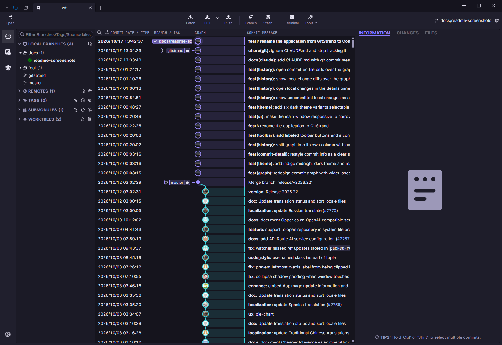
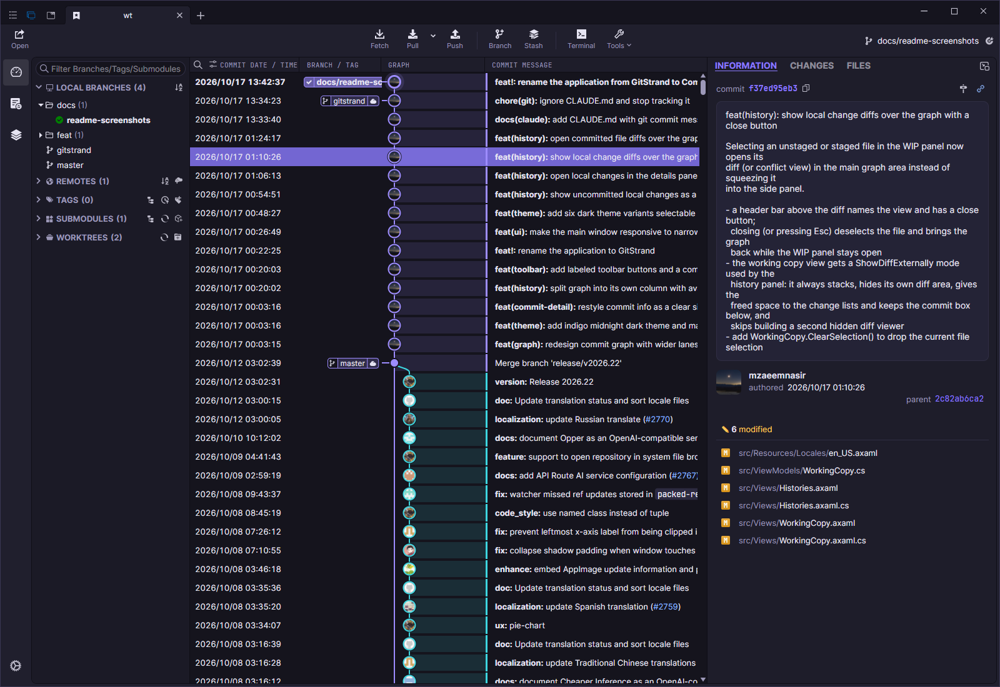
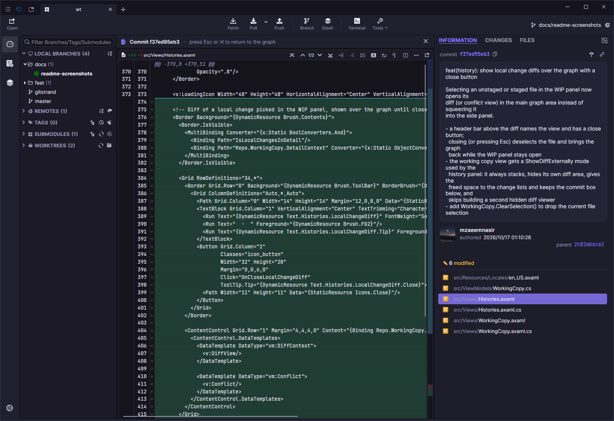
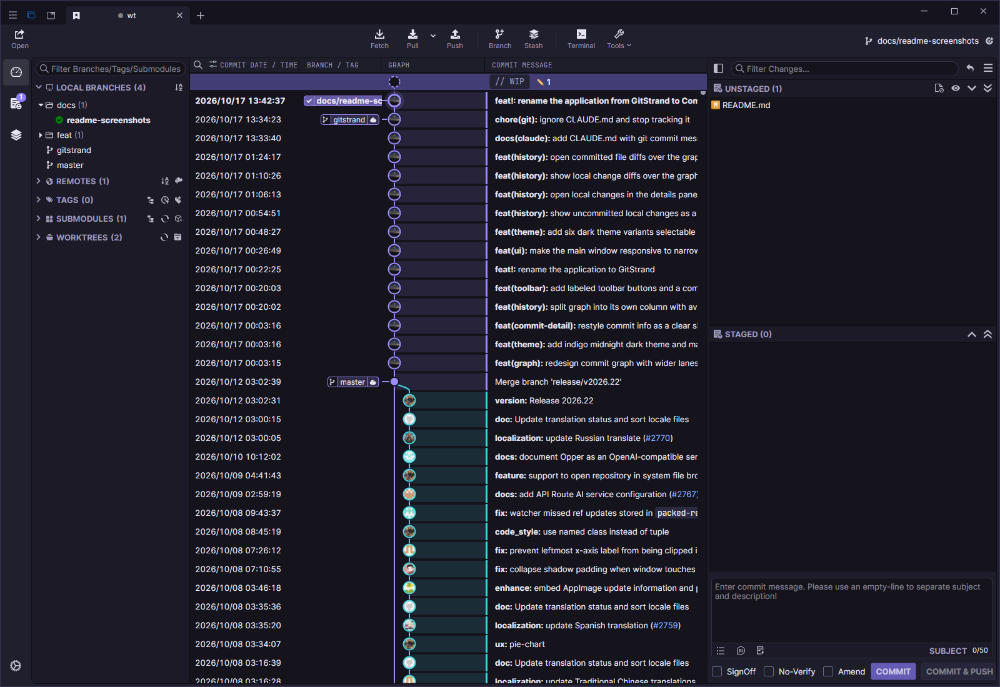
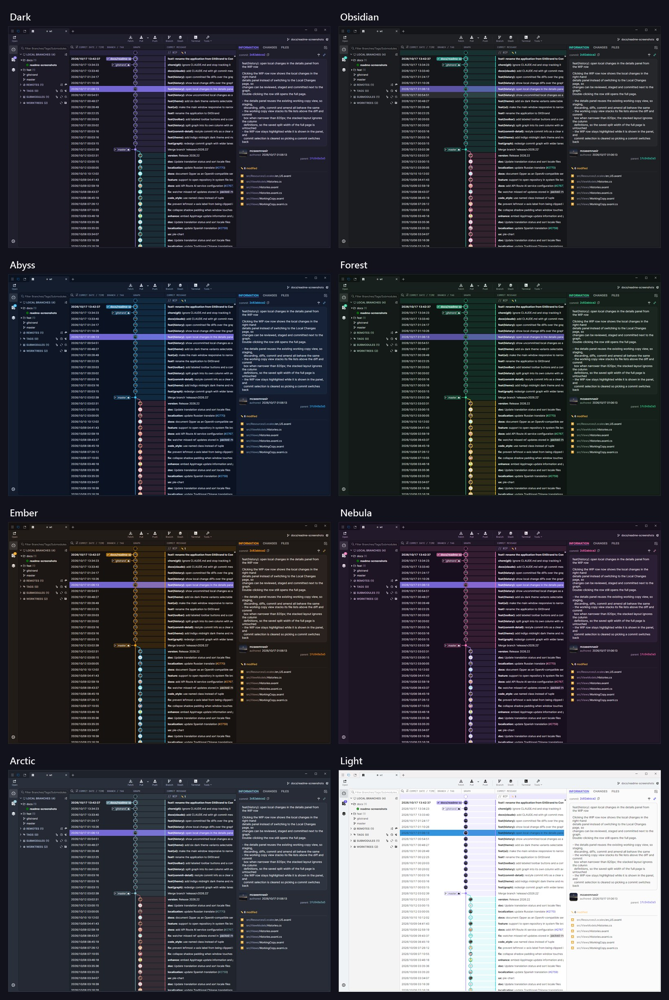
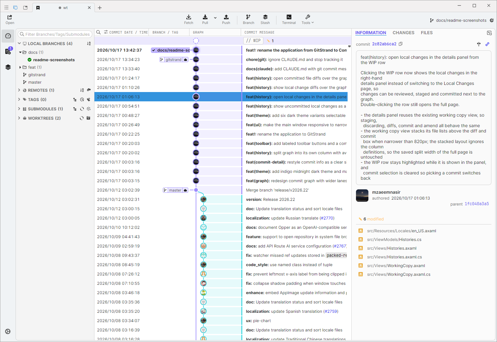

# Commit Dock

A fast, open-source Git GUI client for Windows, macOS and Linux, with a redesigned commit graph, a focused history view and a family of dark themes.

Commit Dock is a fork of [SourceGit](https://github.com/sourcegit-scm/sourcegit) and keeps its full feature set while reworking the look and the day-to-day history workflow.

[](LICENSE)
[](https://github.com/mzaeemnasir/Commit-Dock/stargazers)

## Screenshots

**History**: commit graph with avatar nodes, branch/tag badges and a labeled toolbar



**Commit details**: message, author, parents and changed files in a single scrolling panel



**Diffs over the graph**: open any file of a commit (or of your local changes) in place of the graph; press `Esc` to return



**Local changes**: uncommitted work shows up as a WIP row at the top of the graph



**Themes**: Default, Dark, Obsidian, Abyss, Forest, Ember, Nebula, Arctic and Light, selectable in Preferences





## What's New in Commit Dock

* Redesigned commit graph with wider lanes, glowing nodes and author avatars, in its own column
* Uncommitted local changes shown as a WIP row in the graph, opening the local changes in the details panel
* File diffs (committed or local) open over the graph, with a close button and `Esc` to go back
* Commit details restyled as one clear, single-scroll panel
* Labeled toolbar buttons and a combined Tools menu
* Responsive main window that adapts to narrow sizes
* Indigo midnight dark theme by default, plus six more dark variants and a light theme

## Highlights

* Supports Windows/macOS/Linux
* Open source and free
* Fast
* Deutsch/English/Español/Bahasa Indonesia/Français/Italiano/Português/Русский/Українська/简体中文/繁體中文/日本語/தமிழ் (Tamil)/한국어
* Built-in light/dark themes
* Customize theme
* Visual commit graph
* Supports SSH access with each remote
* GIT commands with GUI
  * Clone/Fetch/Pull/Push...
  * Merge/Rebase/Reset/Revert/Cherry-pick...
  * Amend/Reword/Squash
  * Interactive rebase
  * Branches
  * Remotes
  * Tags
  * Stashes
  * Submodules
  * Worktrees
  * Archive
  * Diff
  * Save as patch/apply
  * File histories
  * Blame
  * Revision Diffs
  * Branch Diff
  * Image Diff - Side-By-Side/Swipe/Blend
* Git command logs
* Search commits
* GitFlow
* Git LFS
* Bisect
* Issue Link
* Workspace
* Custom Action
* Create PR on GitHub/Gitlab/Gitea/Gitee/Bitbucket...
* Using AI to generate commit message
* Built-in conventional commit message helper.

## How to Use

**To use this tool, you need to install Git (>=2.25.1) first.**

Commit Dock does not publish pre-built releases yet. Build it from source (see [Building from Source](#building-from-source)).

Commit Dock stores user settings, downloaded avatars and crash logs in a platform-dependent folder. It does not share settings with SourceGit, so both can be installed side by side.

| OS      | PATH                                                                                                 |
|---------|------------------------------------------------------------------------------------------------------|
| Windows | `%APPDATA%\CommitDock`                                                                               |
| Linux   | `${XDG_CONFIG_HOME}/CommitDock` (preference.json) `${XDG_CACHE_HOME}/CommitDock` (avatars & logs)   |
| macOS   | `~/Library/Application Support/CommitDock`                                                           |

> [!TIP]
> * You can open this data storage directory from the main menu `Open Data Storage Directory`.
> * You can create a `data` folder next to the `CommitDock` executable to force this app to store data (user settings, downloaded avatars and crash logs) into it (Portable-Mode). Only works on Windows and with Linux AppImages.

For **Windows** users:

* **MSYS Git is NOT supported**. Please use official [Git for Windows](https://git-scm.com/download/win) instead.

> [!NOTE]
> `git-flow` is no longer shipped with **Git for Windows** since `2.51.1`. You can use it by following these steps:
>  * Download [git-flow-next](https://github.com/gittower/git-flow-next/releases)
>  * Unzip & Rename the `git-flow-next` to `git-flow`
>  * Copy to `$GIT_INSTALL_DIR/cmd` or just add its path to your `PATH` directly

For **macOS** users:

* Make sure [git-credential-manager](https://github.com/git-ecosystem/git-credential-manager/releases) is installed on your mac.
* You can run `echo $PATH > ~/Library/Application\ Support/CommitDock/PATH` to generate a custom PATH env file to introduce `PATH` env to Commit Dock.

For **Linux** users:

* Make sure [git-credential-manager](https://github.com/git-ecosystem/git-credential-manager/releases) or [git-credential-libsecret](https://pkgs.org/search/?q=git-credential-libsecret) is installed on your Linux.
* `xdg-open` (`xdg-utils`) must be installed to support opening the native file manager.
* Maybe you need to set environment variable `AVALONIA_SCREEN_SCALE_FACTORS`. See https://github.com/AvaloniaUI/Avalonia/wiki/Configuring-X11-per-monitor-DPI.
* If you can NOT type accented characters, such as `ê`, `ó`, try to set the environment variable `AVALONIA_IM_MODULE` to `none`.

## Commandline arguments

Users can also launch `CommitDock` from the commandline. Usage:

```
<COMMITDOCK_EXEC> <DIR>                       // Open repository in existing `Commit Dock` instance or a new one
<COMMITDOCK_EXEC> --history <FILE_OR_DIR>     // Launch `Commit Dock` to see the history of a file or dir
<COMMITDOCK_EXEC> --blame <FILE_PATH>         // Launch `Commit Dock` to blame a file (HEAD version only)
```

## OpenAI

This software supports using OpenAI or other AI service that has an OpenAI compatible HTTP API to generate commit message. You need configurate the service in `Preference` window.

For `OpenAI`:

* `Server` must be `https://api.openai.com/v1`

For `OrcaRouter`:

* `Server` should be `https://api.orcarouter.ai/v1`
* `API Key` should be an OrcaRouter API key (prefixed with `sk-orca-`)
* A good starting `Model` is `orcarouter/auto`, which routes each request to the best available model

For `Cheaper Inference`:

* `Server` should be `https://api.cheaperinference.com/v1`
* `API Key` should be a Cheaper Inference API key (prefixed with `ci_live_`)
* A good starting `Model` is `gpt-5.4-mini`

For `Opper`:

* `Server` should be `https://api.opper.ai/v3/compat`
* `API Key` should be an Opper API key, created at https://platform.opper.ai
* A good starting `Model` is `gpt-5.4-mini`

For `API Route`:

* `Server` should be `https://global.api-route.com/v1`
* `API Key` should be your API Route API key
* `Model` can be `gpt-6.1-sol` if it is available to your key; otherwise select an available chat model from the fetched catalog
* See the [API documentation](https://github.com/DennyHo0917/api-route/blob/main/API.md) for authentication and model discovery

For other AI service:

* The `Server` should fill in a URL equivalent to OpenAI's `https://api.openai.com/v1`. For example, when using `Ollama`, it should be `http://localhost:11434/v1` instead of `http://localhost:11434/api/generate`
* The `API Key` is optional that depends on the service

## External Tools

This app supports open repository in external tools listed in the table below.

| Tool                          | Windows | macOS | Linux |
|-------------------------------|---------|-------|-------|
| Visual Studio Code            | YES     | YES   | YES   |
| Visual Studio Code - Insiders | YES     | YES   | YES   |
| VSCodium                      | YES     | YES   | YES   |
| Cursor                        | YES     | YES   | YES   |
| Sublime Text                  | YES     | YES   | YES   |
| Zed                           | YES     | YES   | YES   |
| Visual Studio                 | YES     | NO    | NO    |

> [!NOTE]
> This app will try to find those tools based on some pre-defined or expected locations automatically. If you are using one portable version of these tools, it will not be detected by this app.  
> To solve this problem you can add a file named `external_editors.json` in app data storage directory (config dir for Linux) and provide the path directly.  
> User can also exclude some editors by using `external_editors.json`.

The format of `external_editors.json`:
```json
{
    "tools": {
        "Visual Studio Code": "D:\\VSCode\\Code.exe"
    },
    "excludes": [
        "Visual Studio Community 2019"
    ]
}
```

> [!NOTE]
> This app also supports a lot of `JetBrains` IDEs, installing `JetBrains Toolbox` will help this app to find them.

## Conventional Commit Helper

You can define your own conventional commit types (per-repository) by following steps:

1. Create a json file with your own conventional commit type definitions. For example:
```json
[
  {
    "Name": "New Feature",
    "Type": "Feature",
    "Description": "Adding a new feature",
    "PrefillShortDesc": "this is a test"
  },
  {
    "Name": "Bug Fixes",
    "Type": "Fix",
    "Description": "Fixing a bug"
  }
]
```
2. Configure the `Conventional Commit Types` in repository configuration window.  

## Building from Source

This project has a submodule in `depends/AvaloniaEdit` which is a custom fork of [Official AvaloniaEdit](https://github.com/AvaloniaUI/AvaloniaEdit).
Clone with `--recurse-submodules`, or run `git submodule update --init` after cloning.

Once the [.NET SDK](https://dotnet.microsoft.com/en-us/download) is installed:

```sh
git clone --recurse-submodules https://github.com/mzaeemnasir/Commit-Dock.git
cd Commit-Dock
dotnet restore
dotnet build
dotnet run --project src/SourceGit.csproj
```

## Contributing

Everyone is welcome to submit a PR. Please base your work on the latest `master` branch, use a separate branch per feature, and target `master` with your PR.

## Credits

Commit Dock is built on [SourceGit](https://github.com/sourcegit-scm/sourcegit) by sourcegit-scm and its contributors. Thanks to everyone who made it possible.

## Translation Status

You can find the current translation status in [TRANSLATION.md](TRANSLATION.md)

### Translate Utility Script

A script that assists with translations by reading the target language, comparing it with the base language, and going through missing keys one by one, so the translator can provide the translations interactively without needing to check each key manually.

#### Usage

Check for a given language (e.g., `pt_BR`) and optionally check for missing translations:

```bash
python translate_helper.py pt_BR [--check]
```

- `pt_BR` is the target language code (change as needed), it should correspond to a file named `pt_BR.axaml` in the `src/Resources/Locales/` directory, so you can replace it with any other language code you want to translate, e.g., `de_DE`, `es_ES`, etc.
- `--check` is an optional flag used to only check for missing keys without prompting for translations, useful for getting a list of missing translations.

The script will read the base language file (`en_US.axaml`) and the target language file (e.g., `pt_BR.axaml`), identify missing keys, and prompt you to provide translations for those keys. If the `--check` flag is used, it will only list the missing keys without prompting for translations.

## Third-Party Components

For detailed license information, see [THIRD-PARTY-LICENSES.md](THIRD-PARTY-LICENSES.md).
